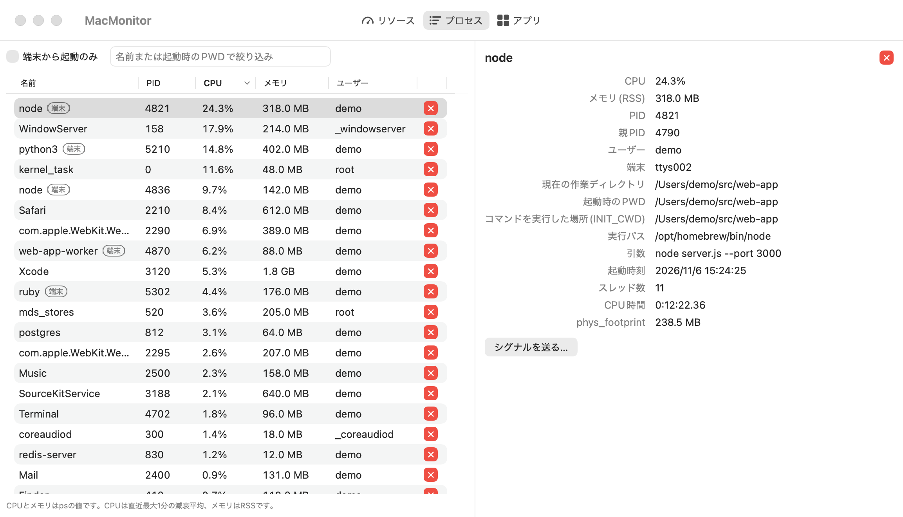
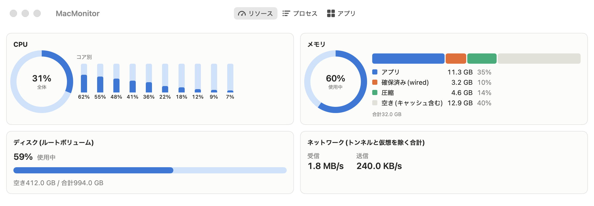
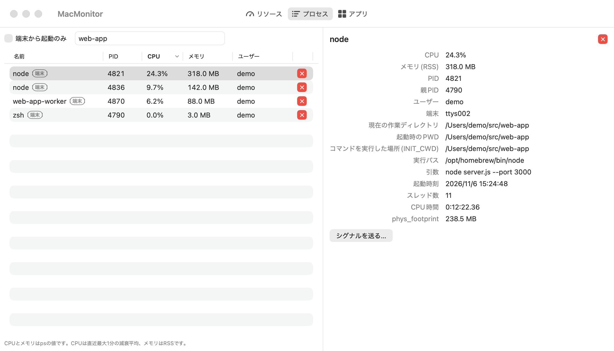
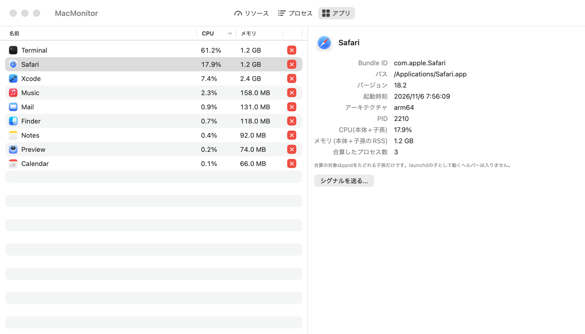
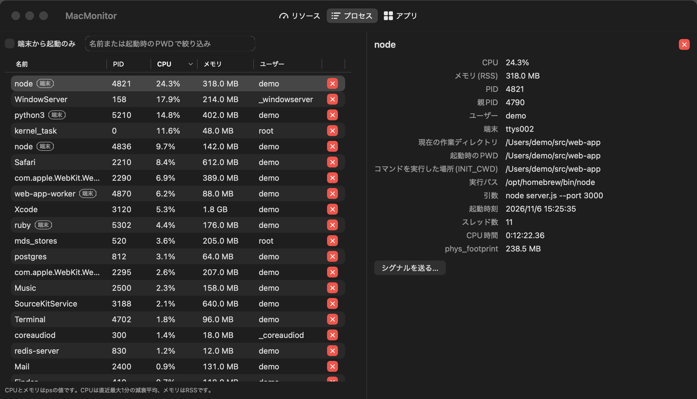

# MacMonitor

MacMonitorは、アクティビティモニタのようなmacOSアプリです。重いプロセスや起動中のアプリを一覧で確かめ、選んだプロセスを終了できます。CPU、メモリ、ディスク、ネットワークの現在値は、ウィンドウとメニューバーに5秒ごとに表示します。



スクリーンショットのプロセス名、ユーザー名、パス、数値は、撮影用の架空のデータです。

## 機能

### リソース

CPUの使用率は、全体の値とコア別の値を表示します。メモリの使用量は、アプリ、確保済み(wired)、圧縮、空きの内訳を積み上げたバーで示します。ディスクはルートボリュームの使用率を、ネットワークは受信と送信の速度を出します。



### プロセス

CPUかメモリの多い順に、上位30件のプロセスを一覧にします。CPUとメモリの列の見出しを押すと、並び順が切り替わります。

- 端末から起動したプロセスには「端末」のタグが付きます。「端末から起動のみ」にチェックを入れると、タグの付いたものだけを表示します。
- 検索欄に入力すると、プロセス名か起動時のPWDに入力した文字を含むものだけを表示します。下の画像では`web-app`で検索し、名前で一致した`web-app-worker`と、PWDが`/Users/demo/src/web-app`の`node`と`zsh`が残っています。
- 行を選ぶと、右の詳細ペインに実行パス、引数、起動時刻、現在の作業ディレクトリ、起動時のPWDなどを表示します。npm、yarn、pnpm経由で起動したプロセスでは、コマンドを実行した場所(`INIT_CWD`)も表示します。
- 行の右端か詳細ペインの赤い×ボタンを押すと、確認ダイアログが開きます。ダイアログで「終了(SIGTERM)」か「強制終了(SIGKILL)」を選ぶと、そのプロセスにシグナルを送ります。



### アプリ

起動中のアプリを、本体と子孫のプロセスを合算したCPUとメモリと一緒に一覧にします。名前、CPU、メモリの列の見出しを押すと並べ替えられ、同じ見出しをもう一度押すと逆順になります。プロセスと同じく、アプリにも×ボタンからシグナルを送れます。



### メニューバーとダークモード

メニューバーには、CPUとメモリの使用率を常に表示します。ウィンドウを閉じてもアプリは動き続けるので、ウィンドウを開き直すときやアプリを終了するときはメニューバーを使ってください。画面の配色は、システムのダークモードの設定に合わせて切り替わります。



## 動作環境

macOS 14以降で動きます。App Sandboxは無効で、外部ライブラリは使っていません。ビルドにはXcodeのSwift(Swift 6系)が必要です。

## ビルドと起動

```bash
git clone https://github.com/petitviolet/mac-monitor.git
cd mac-monitor
make app                    # build/MacMonitor.appを生成し、ad-hocで署名する
open build/MacMonitor.app
```

`build/MacMonitor.app`を`/Applications`にコピーすれば、Spotlightなどからも起動できます。終了するときは、メニューバーの表示をクリックして「終了」を選んでください。

## 開発

```bash
make test       # 全テストを実行し、全出力を表示する
make test-ai    # 全テストを実行し、失敗と最終行だけを表示する
make icons      # アイコンの原画からResources/のアイコンを作り直す(uvが必要)
```

`assets-src/icons/`の原画はCodexで生成したもので、生成に使ったプロンプトも同じ場所にあります。`make icons`の生成物はリポジトリに入れているので、`make app`のたびには作り直しません。

## 既知の制約

- 履歴は持たず、現在値だけを表示します。
- CPU%は`ps`の減衰平均(直近最大1分)なので、瞬間値とは異なります。
- 管理者権限へ昇格しないので、他のユーザーのプロセスへのシグナルは「権限がありません」で失敗します。PID 0、PID 1、MacMonitor自身には送れません。
- 他のユーザーのプロセスでは、詳細の一部の項目が「権限なし」になります。CPU使用率とRSSは`/bin/ps`から読むので、全プロセス分を表示できます。
- メモリの「空き」は合計からアプリ、wired、圧縮を引いた残りで、再利用できるファイルキャッシュを含みます。
- ネットワーク速度は、動作中のインターフェースごとの差分の合計です。同じ通信を二重に数える`utun`、`awdl`、`llw`、`bridge`などのトンネルと仮想インターフェースは除きます。新しく現れたインターフェースは、次の計測まで0として扱います。
- プロセス一覧の並べ替えはCPUとメモリの多い順だけで、同じ見出しを押しても少ない順にはなりません。「端末から起動のみ」や検索で絞り込んだときは、絞り込んだ後の上位30件を表示します。
- 「端末」のタグは、`ttys`で始まるTTYがあるか、ppidを辿った祖先に`zsh`、`bash`、`fish`、`tcsh`、`ksh`、`nu`がいるプロセスに付きます。`sh`は目印にしません。端末を閉じて親を失ったプロセスは、TTYが外れて親がlaunchdになるので、端末から起動したものと判定できません。
- 「起動時のPWD」は、プロセスが親から引き継いだ環境変数`PWD`で、起動したときに親のシェルがいた場所を示します。環境変数は`PWD`と`INIT_CWD`の2つだけを読み、ほかの値は保持しません。
- 環境変数が1つも返らないプロセスでは、「起動時のPWD」に「読み取れません」と出ます。実測では`/bin`などにあるAppleのバイナリがこれに当たりますが、`env -i`で起動したプロセスと区別できません。
- 検索は、環境変数を読めないプロセスを名前だけで判定します。PWDは検索欄に文字があるときだけ読み、プロセスごとに1回だけ読んで覚えます。
- アプリタブに出るのは、`activationPolicy`がregularのアプリだけです。
- アプリの合算は、ppidをたどれる子孫だけを数えます。launchdの子として動くヘルパーは入りません。メモリはRSSの単純な合計なので、共有メモリは重複して数えます。別のregularアプリが子孫にいると、そのアプリの値は両方の合算に入ります。
- アプリへのシグナルは、本体のPIDだけに送ります。
- アプリアイコンは全面不透明の画像で、macOS 26ではOSが角丸に切り抜きます。macOS 14と15では角丸が付かない可能性があります。
- 署名はad-hocで、公証していません。

## ライセンス

[MIT License](LICENSE)
